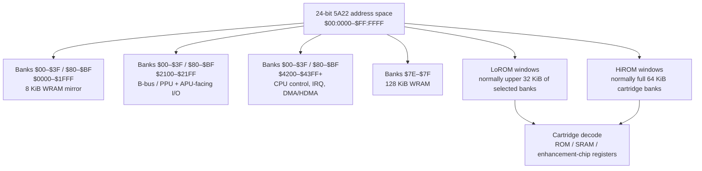
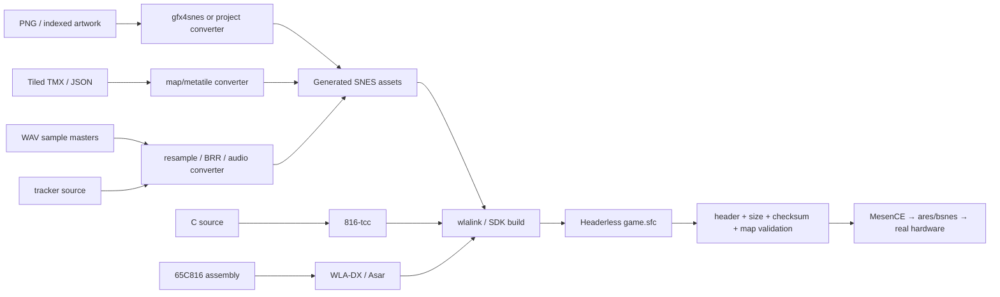
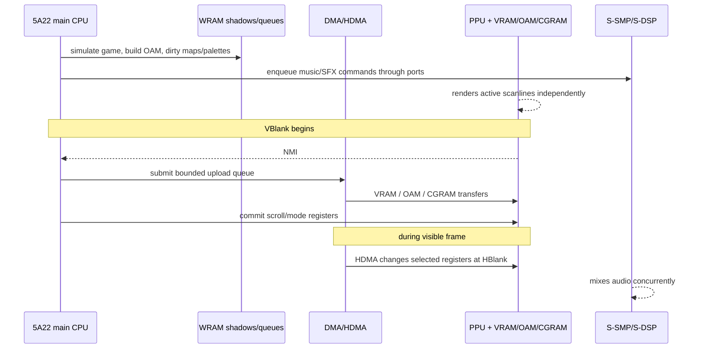
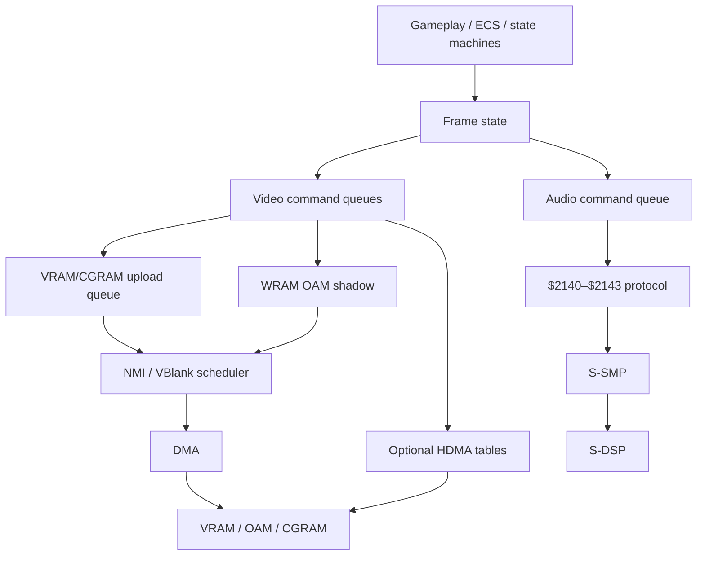

# A Complete, Legally Clean SNES Development Architecture and Workflow

## Executive summary

A modern Super Nintendo/Super Famicom project can be built entirely without Nintendo's proprietary development SDK, leaked developer software, commercial art tools, or copyrighted commercial ROM material. The strongest current route is an **open-source, reproducible toolchain centred on PVSnesLib for C/65C816 development, WLA-DX or Asar for assembly, MesenCE as the primary debugger, ares/bsnes as independent compatibility references, and open-source graphics/audio tools**. PVSnesLib remains actively developed, supports C and assembly, LoROM/HiROM/FastROM, graphics, sprites and SPC700 audio, and its current generated documentation includes DMA, Mode 7, HDMA, sprite and debugging APIs. citeturn19search0turn26search0turn26search2

There is one terminology issue worth resolving immediately: **“licence-free” should not mean “software with no licence”**. Software published without a licence normally gives you fewer permissions, not more. For this report, “licence-free” means **zero-cost, legally obtainable software under explicit open/free-software licences such as MIT, ISC, GPL or LGPL, with no Nintendo SDK dependency and no non-commercial restriction**. This is why, for example, Snes9x is not part of the recommended core despite being downloadable at no charge: its licence contains a non-commercial restriction. citeturn19search24turn20search3

The baseline target I recommend for an unspecified game is:

| Design choice | Recommended baseline | Why |
|---|---|---|
| CPU | Ricoh 5A22 / 65C816 native mode | Full native SNES programming model |
| Cartridge mapping | **LoROM + SlowROM initially** | Easiest mapping to reason about; ample for a first project |
| Enhancement chip | **None** | Maximum emulator/flash-cart/physical-cart simplicity |
| Save hardware | SRAM semantics; FRAM on a purpose-designed modern PCB is reasonable | Familiar software mapping without battery dependence where hardware permits |
| Video | **Mode 1, 256×224** | Best general-purpose mix of 4-bpp backgrounds and a 2-bpp HUD layer |
| Audio | S-SMP/S-DSP through a maintained audio driver | Avoid writing a complete SPC700 music engine initially |
| Language | C for gameplay + 65C816 assembly for IRQ/NMI/DMA/hot paths | Good productivity/performance balance |
| Primary SDK | **PVSnesLib** | Integrated C/ASM libraries and current documentation |
| Debug emulator | **MesenCE** | Current SNES-capable debugger, open-source |
| Accuracy cross-check | **ares**, then **bsnes** | Independent implementations catch emulator-dependent assumptions |
| Hardware test | Original SNES/SFC through a legitimate flash cartridge using only your ROM | Tests electrical/timing behaviour that emulation may not expose |

The machine should be treated as a **CPU plus several concurrent fixed-function devices**, not like a modern CPU/GPU platform. The 5A22 executes gameplay and maintains shadow state; the PPU renders continuously from VRAM/OAM/CGRAM; DMA performs bulk transfers primarily during VBlank; HDMA modifies selected registers during horizontal blanking; and the independent S-SMP/S-DSP audio subsystem continues processing sound while the main CPU runs. Fullsnes documents the 24-bit main address space, separate video memories, eight DMA channels and CPU/APU communication model; SNESdev's register documentation provides the modern register-level reference. citeturn22search0turn21search9

The most important architectural rule is therefore:

> **Do simulation during active display; queue rendering changes in WRAM; commit bounded PPU updates during VBlank; use HDMA only for intentionally scanline-dependent effects; keep audio asynchronous.**

That single rule prevents a large fraction of the timing, graphics-corruption and performance problems encountered in early SNES projects.

Because the target region is unspecified, the engine should be designed against the **tighter NTSC VBlank budget** and tested at both nominal 60 Hz and 50 Hz timings. Do not make game physics implicitly “one unit per frame”; use an explicit region/timing policy if identical game speed matters.

## Hardware architecture and cartridge model

The SNES main processor, the **Ricoh 5A22**, is derived from the WDC 65C816 family. It provides an 8/16-bit programming model, 24-bit addresses and therefore a 16 MiB logical address space. The console does not simply have one fixed “3.58 MHz” CPU speed: external accesses take different numbers of master-clock periods depending on the address range and cartridge speed. Fullsnes describes system regions corresponding roughly to 1.79, 2.68 and 3.58 MHz effective access rates, while the faster WS2 cartridge windows can run at the six-master-clock FastROM rate when configured appropriately. citeturn22search0turn21search3

The useful mental model is:

- the **A-bus** is the 24-bit CPU/cartridge/system-memory address space;
- the **B-bus** contains the `$21xx` peripheral register space;
- DMA hardware can transfer between the two buses efficiently rather than performing a normal CPU load followed by a normal CPU store. citeturn22search0

The main system-visible memories are 128 KiB of WRAM, 64 KiB of PPU VRAM, 544 bytes of OAM, 512 bytes of CGRAM, and a separate 64 KiB APU RAM. VRAM, OAM and CGRAM are not conventional CPU-addressable RAM: they are accessed through PPU ports, normally during VBlank or forced blank, with DMA being the preferred mechanism for substantial transfers. APU RAM is even more isolated: the main CPU communicates with the S-SMP through four communication ports rather than directly mapping or DMAing into its RAM. citeturn22search0turn21search9

A practical overview of the CPU map is:



This is deliberately a **logical map**, because the cartridge controls what it returns for cartridge-space addresses. Fullsnes gives the representative base map as `$00–$3F:8000–FFFF` and `$80–$BF:8000–FFFF` for LoROM windows, `$40–$7D` and `$C0–$FF` for HiROM windows, and `$7E–$7F` for WRAM. citeturn22search0

**LoROM and HiROM are address-decoding schemes rather than NES-style programmable “mappers”.** Conventional LoROM exposes ROM in 32 KiB pieces while keeping system/I/O space visible in the same CPU banks; HiROM presents 64 KiB ROM-oriented banks and is attractive for larger contiguous data. Basic LoROM is conventionally limited to roughly 2 MiB within its straightforward windows and basic HiROM to roughly 4 MiB; extended layouts and enhancement chips can expose more. citeturn22search0turn0search0

For a new project, choose the mapping at link time and make the linker map authoritative. Do **not** scatter hand-computed ROM-bank constants throughout gameplay code.

A representative base map for a LoROM game might be:

| Address | Purpose |
|---|---|
| `$00–$3F/$80–$BF:0000–1FFF` | first 8 KiB WRAM mirror |
| `$00–$3F/$80–$BF:2100–21FF` | PPU/B-bus and related registers |
| `$00–$3F/$80–$BF:4000–41FF` | slow joypad/control area |
| `$00–$3F/$80–$BF:4200–43FF` | CPU control, IRQ and DMA |
| `$7E:0000–FFFF` | WRAM bank zero |
| `$7F:0000–FFFF` | WRAM bank one |
| `$00–$7D/$80–$FF:8000–FFFF` as decoded | LoROM cartridge data/code |
| `$70–$7D/$F0–$FF:0000–7FFF`, board-dependent | conventional LoROM save SRAM |

Fullsnes documents conventional battery-backed HiROM SRAM at `$30–$3F/$B0–$BF:6000–7FFF` and LoROM SRAM around `$70–$7D/$F0–$FF:0000–7FFF`, while also noting that real boards contain mirrors and variations. citeturn22search0

The internal cartridge header is another area where development documents frequently become confused with historical copier formats. A modern homebrew build should normally produce a **headerless `.sfc` image**. The SNES internal header is embedded in the ROM itself, conventionally appearing at file offset approximately `0x7FC0` for LoROM, `0xFFC0` for HiROM and `0x40FFC0` for ExHiROM. A separate 512-byte copier header is not part of the cartridge ROM and should not be emitted by the canonical build. SNESdev's current ROM-header documentation identifies the mapping/speed and cartridge-chip fields, while PVSnesLib documents the same internal-header model. citeturn22search1turn0search8

Key header information includes:

| CPU-header location | Meaning |
|---|---|
| around `$FFC0` | ROM title |
| `$FFD5` | mapping/speed mode |
| `$FFD6` | cartridge chipset: ROM/RAM/battery/enhancement-chip class |
| `$FFD7` | ROM-size encoding |
| `$FFD8` | SRAM-size encoding |
| `$FFD9` | destination/region code |
| `$FFDC–FFDD` | checksum complement |
| `$FFDE–FFDF` | checksum |
| `$FFE0–FFFF` | native/emulation exception-vector area |

Interrupt handling is central to the programming model. `$4200` controls VBlank NMI, H/V IRQ configuration and automatic joypad polling; associated timer registers select horizontal/vertical IRQ positions. The native 65C816 vector table contains separate NMI, IRQ, BRK, COP and abort vectors, while reset begins through the emulation-mode reset vector. citeturn21search0turn22search0

For game-engine purposes:

**NMI** should be your frame-commit mechanism. It fires at VBlank when enabled.

**IRQ** should normally be reserved for deliberate raster splits or other timing-sensitive events.

**DMA** should move bulk graphics/palette/OAM data.

**HDMA** should implement repeated per-scanline register changes such as scrolling, colour gradients, window edges or Mode 7 parameters.

There are eight DMA/HDMA channels. General DMA is started through `$420B`, HDMA channels through `$420C`, and each channel has its register block at `$43x0–$43xF`. The DMA engine can target consecutive/repeated B-bus registers according to transfer modes; Fullsnes describes the baseline transfer cost as eight master clocks per byte, with initial synchronisation/setup effects on top. citeturn21search0turn21search2

The PPU should be understood as a **two-chip fixed-function graphics complex**, historically S-PPU1/S-PPU2, rather than a programmable GPU. Its public programming model consists of `$2100–$213F`: background mode and tile-map addresses, character data addresses, OAM, VRAM ports, Mode 7 matrix values, windows, main/sub-screen selection, colour math and display configuration. SNESdev's register reference documents this division in detail. citeturn21search9

PPU1/PPU2 collectively consume:

- background tile maps and bitplane graphics from 64 KiB VRAM;
- object definitions from 544-byte OAM;
- 256 15-bit colours from 512-byte CGRAM;
- scrolling, window, priority and colour-math state from registers.

CGRAM colours are stored in the SNES's 15-bit BGR format; VRAM is word-oriented at the `$2116/$2117` address interface; VRAM reads and writes outside VBlank/forced blank are constrained by active PPU access. citeturn21search9turn22search0

The audio computer is almost a machine of its own. The **S-SMP** executes the Sony SPC700-compatible instruction set at about 1.024 MHz, has 64 KiB local audio RAM, timers and I/O, and drives the **S-DSP**, which supplies eight sampled voices, envelopes, echo/FIR facilities, pitch modulation and noise generation. Main-CPU communication occurs through four software-visible ports corresponding to `$2140–$2143` on the 5A22 side and `$F4–$F7` on the SPC700 side. citeturn5search0turn5search6turn22search0

SNES sample data is normally stored using **BRR, Bit Rate Reduction**. A BRR block occupies nine bytes: an eight-bit control/header byte followed by eight bytes containing four-bit sample nibbles, reconstructing sixteen PCM samples. citeturn5search29turn6search31

Finally, cartridge enhancement chips are not all one architectural family:

| Enhancement | Role relevant to a developer |
|---|---|
| **DSP-1/1B/2/3/4** | NEC DSP-family fixed-function maths/data-processing variants; DSP-1 is particularly associated with geometry/coordinate calculations |
| **SuperFX / GSU** | programmable cartridge-side RISC processor with graphics-oriented caches and pixel operations |
| **SA-1** | much faster 65C816-like processor, IRAM/BW-RAM, DMA, arithmetic, bit processing and programmable memory mapping |
| **Cx4** | Capcom computation/geometry processor |
| **S-DD1** | data decompression hardware and associated mapping |
| **SPC7110** | data decompression/mapping functions; some cartridges add RTC functionality |
| **S-RTC** | dedicated real-time clock |
| **OBC1** | object-data assistance |
| **ST010/ST011** | DSP-based computation devices |
| **ST018** | ARM-based cartridge processor |

Fullsnes contains register/memory-map sections for these chips, while the Super Famicom Development Wiki indexes individual expansion-chip documentation. SA-1, for example, contains a roughly 10.74 MHz 65C816-class processor plus 2 KiB internal RAM and dedicated DMA/data-conversion facilities. citeturn22search0turn23search2

For a new game, however, **no enhancement chip should be the default**. Every enhancement chip substantially expands the testing matrix, cartridge hardware problem and emulator/flash-cart dependency surface.

## Development environment and licence-cleared toolchain

The following stack deliberately favours official project repositories, explicit open licences and tools that can be incorporated into a reproducible build without relying on Nintendo material.

| Tool | Role | Licence | Hosts | Maturity / recommendation | Legal/integration note |
|---|---|---|---|---|---|
| [PVSnesLib](https://github.com/alekmaul/pvsneslib) | SNES C/ASM SDK, libraries, examples, asset/audio tools | MIT for PVSnesLib/affiliated code | Windows, Linux, macOS | **High; primary SDK** | Explicitly open/free; keep MIT notice in third-party notices. Current docs expose graphics, DMA, sprites, Mode 7, SPC and debugging APIs. citeturn13view0turn26search0 |
| [816-tcc](https://github.com/alekmaul/tcc) | 65C816 C compiler used with PVSnesLib | LGPL-2.1-family | PVSnesLib-supported hosts | **Medium-high; practical C compiler** | Optimisation quality is lower than a modern desktop compiler; use C for structure and ASM for critical paths. citeturn15search2 |
| [WLA-DX](https://github.com/vhelin/wla-dx) | `wla-65816`, SPC700 assembler, `wlalink` | GPL-2.0-or-later | Cross-platform | **High** | Strong choice for full ROMs; explicitly supports SNES header/vector/linker directives and both 65816/SPC700. citeturn1search6turn1search2 |
| [Asar](https://github.com/RPGHacker/asar) | 65C816/SPC700/SuperFX assembler | LGPL-2.0-or-later core; repository contains additional component licences | Source-build cross-platform | **High** | Can build new ROMs from scratch, not only patches. Check component notices if embedding its library rather than merely running the executable. citeturn17search1turn18search4 |
| [MesenCE](https://github.com/nesdev-org/MesenCE) | Emulator/debugger | GPLv3 | Windows, Linux, macOS | **Very high; primary debugger** | Current community-maintained Mesen line; 2026 releases include continuing SNES debugger work. citeturn8search5turn8search14 |
| [ares](https://github.com/ares-emulator/ares) | Accuracy-oriented multi-system emulator | ISC | Windows, Linux, macOS | **Very high; independent test oracle** | Accuracy/preservation-focused; useful as a second implementation rather than relying exclusively on one debugger. Current project release line reached v148 in 2026. citeturn8search25turn8search16turn18search7 |
| [bsnes](https://github.com/bsnes-emu/bsnes) | Accuracy-oriented SNES emulator | GPLv3 | Windows, Linux, macOS | **High / mature** | Particularly useful as an additional compatibility test; historically strong coprocessor coverage. citeturn0search2turn8search21 |
| PVSnesLib `gfx4snes` and converters | PNG/graphics → SNES tiles/maps/palettes | PVSnesLib project licensing | SDK hosts | **High for PVS workflow** | Prefer these over old proprietary conversion utilities when using PVSnesLib. citeturn19search0 |
| [Tilemap Studio](https://github.com/Rangi42/tilemap-studio) | Tile-map editor with SNES-oriented use cases | LGPLv3 | Desktop | **Medium-high** | Closer to retro-console tilemaps than a generic modern editor. citeturn9search1turn18search9 |
| [Tiled](https://github.com/mapeditor/tiled) | General level/map editor | GPLv2-family | Windows, Linux, macOS | **Very high** | Excellent for metatile/object authoring, but write an explicit converter from TMX/JSON to your SNES engine format. citeturn9search0turn9search4turn18search2 |
| [LibreSprite](https://github.com/LibreSprite/LibreSprite) | Pixel-art/sprite editor | GPL-2.0 | Windows, Linux, macOS, other ports | **Medium-high** | Open fork from the older GPL codebase; suitable where Aseprite's present licence would not fit the “open-only” requirement. citeturn10search2turn10search1 |
| [GrafX2](https://gitlab.com/GrafX2/grafX2) | Indexed/pixel graphics editor | GPL-2.0 | Multi-platform | **High / mature** | Particularly good for palette-conscious pixel art. citeturn9search27turn9search10 |
| [Furnace](https://github.com/tildearrow/furnace) | Chiptune tracker / S-DSP composition and experimentation | GPL-2.0-or-later | Windows, Linux, macOS | **High as composition/reference tool** | Has explicit SNES/S-DSP support; game-driver export/integration should still be tested against the chosen runtime rather than assumed. citeturn11search5turn27search23 |
| [Audacity](https://github.com/audacity/audacity) | PCM/sample preparation | GPLv3 distribution; individual files have documented variations | Windows, Linux, macOS | **Very high** | Use for trimming, mono conversion, normalisation and controlled resampling before BRR conversion. citeturn19search1turn19search7turn19search10 |

Two tools commonly seen in retro-development guides are deliberately **not** baseline recommendations here. **Snes9x** has a custom licence restricting commercial use, so it fails a robust “possibly commercial homebrew” requirement even though personal use is free. citeturn19search24 **Old Nintendo SDK binaries, leaked assemblers/debuggers, developer ROMs and scanned proprietary software packages should not enter the repository at all.**

There is also no need to use an old SNES-specific graphical editor with uncertain provenance. The safer architecture is **modern open-source editor → transparent build-time converter → native SNES binary assets**.

A useful qualitative comparison of the main engineering tools is:

```text
                       SNES specificity     Maturity     CI friendliness
PVSnesLib              █████                ████▌        █████
WLA-DX                 █████                █████        █████
Asar                   █████                ████▌        █████
MesenCE                █████                ████▌        ████
ares                   ████                 █████        ███
bsnes                  █████                █████        ███
Tilemap Studio         ████▌                ███▌         ███
Tiled                   ██                  █████        █████
LibreSprite             ██                  ████         ██
GrafX2                   ██                  █████        ██
Furnace                 ████                ████▌        ███
Audacity                 █                  █████        ██
```

Those ratings are analytical rather than project-issued scores: “SNES specificity” means how little adaptation is needed for SNES-native assets; “CI friendliness” rewards deterministic command-line components rather than interactive GUI workflows.

**Recommended starter toolchain:** PVSnesLib + 816-tcc + the WLA-DX version pinned by the SDK; MesenCE for debugging; ares for independent verification; LibreSprite or GrafX2 for pixel assets; Tiled for levels; Furnace and Audacity for audio preparation. Keep Asar installed as an excellent standalone assembler, particularly if part of the engine migrates towards an assembly-first architecture.

There is an important licence distinction here. A GPL assembler, debugger or image editor does **not automatically make the ROM it processes GPL** merely because it was executed during the build. The thing to audit is code that is actually incorporated into, linked into or redistributed with your game. In particular, keep a `THIRD_PARTY_NOTICES.md`, preserve the MIT notice for incorporated PVSnesLib code, and separately audit any audio runtime or third-party source you copy into the ROM. If you redistribute the tools themselves or modified builds of GPL/LGPL tools, their redistribution obligations become relevant.

## Project structure, build system and reproducible asset pipeline

There is no official canonical homebrew directory layout, so the following is a **proposed convention optimised for reproducibility, licence auditing and separation between editable source assets and generated SNES data**:

```text
snes-game/
├── README.md
├── LICENSE
├── THIRD_PARTY_NOTICES.md
├── Makefile
├── toolchain.lock
│
├── src/
│   ├── main.c
│   ├── game/
│   │   ├── player.c
│   │   ├── world.c
│   │   └── collision.c
│   ├── engine/
│   │   ├── video.c
│   │   ├── dma_queue.c
│   │   ├── sprites.c
│   │   ├── input.c
│   │   ├── audio.c
│   │   └── save.c
│   └── asm/
│       ├── reset.asm
│       ├── nmi.asm
│       ├── irq.asm
│       └── hotloops.asm
│
├── include/
│   ├── game.h
│   ├── video.h
│   └── memory.h
│
├── link/
│   ├── lorom.link
│   └── rom_header.inc
│
├── assets-src/
│   ├── gfx/
│   │   ├── player.png
│   │   ├── world.png
│   │   └── hud.png
│   ├── maps/
│   │   └── level01.tmx
│   ├── music/
│   └── sfx/
│       └── jump.wav
│
├── assets-gen/
│   ├── tiles/
│   ├── palettes/
│   ├── maps/
│   ├── audio/
│   └── assets.inc
│
├── tools/
│   ├── convert_map.py
│   ├── validate_rom.py
│   └── check_vram_layout.py
│
├── tests/
│   ├── test_map_converter.py
│   ├── test_save_format.py
│   └── test_rom_header.py
│
├── build/
│   ├── obj/
│   ├── game.map
│   ├── game.sym
│   └── game.sfc
│
└── dist/
    ├── game.sfc
    ├── SHA256SUMS
    └── THIRD_PARTY_NOTICES.md
```

The important distinction is that `assets-src/` contains **human-editable canonical originals**, while `assets-gen/` is disposable and recreated on every clean build. Generated bitplanes should never become the master artwork.

The build dependency graph should look like this:



PVSnesLib's examples already demonstrate the model of linking graphics symbols into the ROM and using `bgInitTileSet`, `bgInitMapSet`, `dmaCopyVram`, sprite APIs and VBlank hooks to move them to PPU memory. citeturn26search0turn26search2turn26search4

A build should conceptually perform these stages in this order:

```make
.PHONY: all assets rom validate clean

all: validate

assets:
	# PNG -> planar SNES tiles + palettes
	# TMX -> engine-native metatiles/maps
	# WAV/tracker data -> audio-runtime data

rom: assets
	# Compile C
	# Assemble 65C816/SPC code
	# Link cartridge image + internal SNES header

validate: rom
	python3 tools/validate_rom.py build/game.sfc

clean:
	rm -rf build assets-gen
```

The real PVSnesLib project should call its supplied rules rather than duplicating SDK internals; the wrapper Makefile should pin the SDK revision and pass through configuration such as mapping and ROM speed. WLA-DX's official documentation covers its SNES-specific `.LOROM`, `.SNESHEADER`, native/emulation vector and linker directives. citeturn1search6

The canonical ROM should satisfy four conditions:

1. no 512-byte copier prefix;
2. valid internal header at the location appropriate to the selected mapping;
3. reset/NMI/IRQ vectors pointing into valid ROM;
4. expected final size/padding and internally consistent checksum metadata.

Do not derive mapping from a filename extension. Treat mapping as a **linker configuration plus validated header property**.

For maps, prefer a two-stage representation. Tiled should represent **semantic levels**: layers, objects, collision classes, spawn points and metatile IDs. A small project-owned Python tool should convert that into compact SNES data. This avoids making runtime code understand TMX/XML/JSON and lets you optimise storage later without changing how designers work. Tiled's design explicitly supports arbitrary properties/layers and is therefore well suited to this separation. citeturn9search0

A useful native level format might be:

```text
LevelHeader
  u16 width_metatiles
  u16 height_metatiles
  u16 tileset_id
  u16 palette_id
  u24 map_data_ptr
  u24 object_data_ptr

MapData
  metatile IDs, optionally compressed

ObjectData
  type, x, y, parameter...
```

Use **metatiles** such as 16×16 or 32×32 logical blocks composed from 8×8 hardware tiles. Large worlds then store one logical ID instead of four or sixteen complete SNES tile-map entries.

A reproducible CI job should pin toolchain versions or commit hashes and then:

```text
checkout
→ verify tool hashes
→ run host-side unit tests
→ rebuild every generated asset
→ compile/assemble/link
→ validate header/vectors/ROM size
→ ensure no untracked generated differences
→ SHA-256 final ROM
→ optional emulator smoke test
→ archive .sfc + symbols + map + licence notices
```

Do not upload compilers/emulators into your release merely for convenience. A bootstrap script that obtains the official upstream version avoids turning your project into a distributor of multiple GPL/LGPL binaries and substantially simplifies compliance.

## Graphics engine and CPU–PPU coordination

The SNES provides eight background modes. The most useful high-level summary is:

| Mode | Background capability | Typical use |
|---|---|---|
| **0** | 4 × 2-bpp BG | many low-colour layers |
| **1** | 2 × 4-bpp + 1 × 2-bpp | **general 2D games; recommended default** |
| **2** | 2 × 4-bpp with offset-per-tile effects | per-column/per-tile scrolling effects |
| **3** | 1 × 8-bpp + 1 × 4-bpp | richer-colour main BG |
| **4** | 1 × 8-bpp + 1 × 2-bpp, offset effects | colour-rich layer plus secondary layer |
| **5** | 4-bpp + 2-bpp high-resolution arrangement | high-resolution content |
| **6** | 4-bpp high-resolution layer with offset effects | specialised high-res effects |
| **7** | affine transformed indexed background; optional EXTBG behaviour | rotation/scaling, pseudo-3D ground |

`$2105` selects the mode and per-background tile size; `$2107–$210A` select tile-map locations, while `$210B/$210C` select background character-data bases. Mode 7 gets its matrix and centre registers at `$211B–$2120`. citeturn21search9turn2search28

The PPU is **not** a framebuffer GPU in the normal case. The efficient renderer builds a scene from small reusable tiles, tile maps and OAM descriptors.

Tile storage costs are:

```text
2 bpp 8×8 tile  = 16 bytes
4 bpp 8×8 tile  = 32 bytes
8 bpp 8×8 tile  = 64 bytes
```

This leads naturally to **Mode 1** as a general-purpose baseline: two visually rich 4-bpp scrolling layers and a cheaper 2-bpp layer for a HUD or other low-colour content.

A proposed VRAM **byte-offset** plan for a medium-sized Mode 1 engine is:

| VRAM bytes | Allocation |
|---|---|
| `$0000–1FFF` | BG1 4-bpp tiles: up to 256 tiles |
| `$2000–2FFF` | BG2 4-bpp tiles: up to 128 tiles |
| `$3000–37FF` | BG3 2-bpp tiles: up to 128 tiles |
| `$3800–3FFF` | reserve / streamed background tiles |
| `$4000–47FF` | BG1 32×32 tile map |
| `$4800–4FFF` | BG2 32×32 tile map |
| `$5000–57FF` | BG3 32×32 tile map |
| `$5800–BFFF` | streamed maps/tiles, double-window space |
| `$C000–FFFF` | OBJ character graphics |

**Important:** that table uses byte offsets for human readability. The raw VRAM address written through `$2116/$2117` is a **word address**, so the register value is `byte_offset / 2`. SNESdev explicitly documents `VMADD` as a word address. citeturn21search9

This should live in one machine-readable engine file rather than comments scattered through C code:

```c
enum {
    VRAM_BG1_GFX = 0x0000, /* engine/library convention */
    VRAM_BG2_GFX = 0x1000,
    VRAM_BG3_GFX = 0x1800,
    VRAM_BG1_MAP = 0x2000,
    VRAM_BG2_MAP = 0x2400,
    VRAM_BG3_MAP = 0x2800,
    VRAM_OBJ_GFX = 0x6000
};
```

When using PVSnesLib, follow **its documented address convention** for calls such as `dmaCopyVram`; when touching `$2116/$2117` yourself, remember the hardware register uses VRAM word addresses. PVSnesLib's current example code explicitly combines `bgSetMapPtr`, `bgInitTileSet`, `dmaCopyVram`, `setMode()` and VBlank callbacks. citeturn26search2

The engine should maintain three classes of graphics state in WRAM:

**Static state** is copied once during loading: most tile graphics, fixed palettes and immutable maps.

**Frame state** changes each frame: OAM shadow, scroll positions, animation tile updates and dirty palette ranges.

**Streaming state** changes occasionally: new map pages, tilesets, cut-scene graphics and dynamic sprite tiles.

Never generate OAM piecemeal directly in PPU memory during gameplay. Build an **OAM shadow table in WRAM**, perform culling/sorting there, and DMA the resulting block during VBlank. Hardware has 128 OAM entries and finite per-scanline sprite evaluation capacity; robust engines should avoid designs that depend on drawing unlimited overlapping objects, and should watch the sprite overflow indicators exposed through `STAT77`. citeturn5search14turn21search9

Similarly, maintain a **VRAM upload queue** rather than allowing arbitrary gameplay systems to call DMA. For example:

```c
typedef enum {
    UPLOAD_VRAM,
    UPLOAD_CGRAM,
    UPLOAD_OAM
} UploadType;

typedef struct {
    UploadType type;
    const void *src;
    unsigned short dst;
    unsigned short size;
} UploadCommand;
```

At the end of game simulation, gameplay publishes a bounded command list. NMI consumes the list until the current frame's transfer budget is exhausted; anything non-critical remains queued for the next frame.

This removes the dangerous coupling:

```text
"opening inventory" -> unexpectedly DMA 17 KiB -> missed frame
```

and replaces it with:

```text
"opening inventory" -> enqueue tiles/map/palette
                   -> upload over one or more scheduled VBlanks
                   -> switch display state when complete
```

The CPU/PPU/APU relationship should look like this:



The four-port CPU/APU link and the PPU/DMA arrangement are documented independently by Fullsnes and SNESdev. citeturn22search0turn21search9

A compact raw 65C816 DMA example illustrates why the hardware is so useful. This example transfers 2 KiB from ROM address `$80:8000` into VRAM word address `$2000`:

```asm
; 65C816-style example.
; Run only when VRAM access is safe (normally VBlank/forced blank).
; A is 8-bit here.

        sep #$20

        ; VRAM increment after high byte ($2119).
        lda #$80
        sta $2115

        ; VRAM destination = word address $2000.
        lda #$00
        sta $2116
        lda #$20
        sta $2117

        ; DMA channel 0.
        ; Mode 1 alternates $2118, $2119:
        ; low byte, high byte, low byte, high byte...
        lda #$01
        sta $4300

        ; B-bus destination $21:18.
        lda #$18
        sta $4301

        ; A-bus source = $80:8000.
        lda #$00
        sta $4302
        lda #$80
        sta $4303
        lda #$80
        sta $4304

        ; Transfer length = $0800 bytes.
        lda #$00
        sta $4305
        lda #$08
        sta $4306

        ; Start channel 0.
        lda #$01
        sta $420B
```

The register selection follows the documented VRAM ports `$2115–$2119` and channel-0 DMA registers `$4300+`; transfer mode 1 alternates the two consecutive VRAM data ports. citeturn21search9turn21search0

The equivalent engine-level operation in PVSnesLib is intentionally much smaller:

```c
#include <snes.h>

static u8 *pending_src;
static u16 pending_vram;
static u16 pending_size;
static volatile u8 pending;

static void vblank_upload(void)
{
    /*
     * Publish 'pending' only after the main thread has filled
     * pending_src/pending_vram/pending_size.
     */
    if (vblank_flag && pending) {
        dmaCopyVram(pending_src, pending_vram, pending_size);
        pending = 0;
    }
}

int main(void)
{
    nmiSet(vblank_upload);

    setMode(BG_MODE1, 0);
    setScreenOn();

    for (;;) {
        /* update_game();       */
        /* build_oam_shadow();  */
        /* queue_vram_work();   */

        WaitForVBlank();
    }
}
```

`nmiSet`, `WaitForVBlank`, `vblank_flag` and `dmaCopyVram` are current documented PVSnesLib facilities; the official continuous-scrolling sample uses essentially this VBlank-upload architecture. citeturn26search0turn26search2

The timing budget explains why queueing matters. NTSC SNES timing is based on a master clock around 21.477 MHz; PAL is around 21.281 MHz. A scanline is approximately 1,364 master clocks and the common frame structures are 262 lines NTSC and 312 PAL, with interlace/field details introducing additional edge cases. citeturn21search4turn22search0

Using those values and Fullsnes' raw eight-master-clock-per-byte DMA rate gives the following **theoretical upper bounds**, before DMA startup alignment, WRAM refresh, CPU/NMI work, HDMA, automatic controller work and safety margin:

| Configuration | Approx. frame | VBlank lines under simple line model | Raw DMA-byte ceiling |
|---|---:|---:|---:|
| NTSC, 224-line display | 16.639 ms / 60.10 Hz | ~37 | ~6,308 B |
| NTSC, 239-line overscan | same frame | ~22 | ~3,751 B |
| PAL, 224-line display | 19.997 ms / 50.01 Hz | ~87 | ~14,833 B |
| PAL, 239-line overscan | same frame | ~72 | ~12,276 B |

These values are **planning ceilings, not promised usable bandwidth**. They are simply `VBlank scanlines × 1364 / 8`. A production engine should deliberately budget below them. Fullsnes documents the eight-clock DMA cadence and timing references document additional CPU/refresh effects. citeturn21search0turn21search2turn21search4

For an NTSC-first engine, a reasonable policy is:

```text
critical every frame
    OAM
    small palette changes
    scroll/mode state

budgeted
    animation tiles
    dirty tile-map spans

background / multi-frame
    large tileset replacement
    full-screen map replacement
    menu/cut-scene asset load
```

The optimiser should therefore reduce **bytes transferred and memory accesses**, not merely instruction count.

High-value optimisations include:

- put hot variables in direct page where architecture/compiler strategy permits;
- use 16-bit accumulator/index modes deliberately rather than constantly switching width;
- structure ROM data so sequential accesses remain in convenient banks;
- enable FastROM only after the base ROM is stable and header/linker configuration agrees;
- keep DMA source blocks from unexpectedly crossing boundaries that your DMA/link strategy does not handle;
- update dirty map rows/columns instead of 2 KiB maps;
- animate characters by changing tile indices when possible rather than copying new pixels;
- use fixed-point maths instead of division-heavy general C;
- reserve HDMA for effects that genuinely need scanline variation;
- profile on real hardware, not only an emulator.

Mode 7 deserves particular caution. The hardware supplies an affine transform, **not an automatic 3-D perspective camera**. The familiar perspective-ground effect is obtained by changing scale/matrix/scroll parameters as scanlines progress, commonly through HDMA. Mode 7 matrix and centre registers are explicitly exposed at `$211B–$2120`; HDMA makes per-line parameter variation economical. citeturn21search9turn5search32

Useful scanline techniques therefore include:

```text
HDMA -> BG horizontal offsets       parallax / water distortion
HDMA -> colour/window registers     gradients / spotlights / wipes
HDMA -> Mode 7 matrix parameters    perspective ground
IRQ  -> mode/layer changes          coarse display splits
HDMA -> window edges                status areas / shaped masks
```

Do not drive every effect with an HIRQ handler. Interrupt handlers consume CPU time and are harder to stabilise; HDMA exists precisely for repeated register writes tied to scanlines.

## Audio system and cartridge hardware

An audio production pipeline should begin with the fact that **ARAM is only 64 KiB and must contain the audio driver, state, music data, sample directory, echo buffer and BRR sample data simultaneously**. The main CPU cannot DMA directly into ARAM; transfers are protocols conducted through the four CPU/APU communication ports. citeturn22search0turn5search6

A clean pipeline is:

```text
original recording / synthesised source
       ↓
Audacity: edit / trim / mono / remove DC / resample
       ↓
master WAV retained in assets-src/
       ↓
BRR conversion / tracker sample import
       ↓
loop validation + memory-size report
       ↓
music module / SFX bank
       ↓
PVSnesLib audio integration
       ↓
S-SMP driver in ARAM
       ↓
S-DSP: 8 voices → hardware output
```

BRR should be regarded as an **asset codec with audible trade-offs**, not merely a file conversion step. Low-frequency material tolerates aggressive resampling better than bright percussive material; looping samples need careful loop points; and large echo buffers reduce the memory available to samples/music.

For a first project, do not write your own SPC700 sequencing/mixing driver unless audio engineering is one of the project's explicit goals. PVSnesLib exposes `spcBoot`, `spcLoad`, `spcPlay`, `spcEffect`, sound-bank and volume routines and therefore provides a more practical starting point. citeturn26search0turn19search0

**Furnace** is valuable because it has an SNES/S-DSP system model and allows music to be composed while thinking in terms of the hardware's actual voice/chip behaviour. Its code is GPL-2.0-or-later and the project remains actively maintained. Production export should nevertheless be considered a separate integration problem: verify exactly what your chosen game audio driver accepts rather than assuming that an arbitrary Furnace project directly becomes the game's runtime format. citeturn11search5turn27search23turn27search19

Keep a machine-readable ARAM budget:

```text
64 KiB total ARAM
- driver/code
- driver variables + stack
- DSP sample directory
- echo buffer
- song/sequence data
- resident SFX samples
- current music samples
= free streaming/swap margin
```

Fail the build if an audio bank exceeds its assigned budget. Do not discover ARAM overflow after composing the soundtrack.

Physical cartridge design should begin with a similarly conservative hierarchy:

| Cartridge architecture | Recommendation | Engineering/legal implications |
|---|---|---|
| LoROM + ROM only | **Excellent first target** | simplest PCB and software map |
| LoROM + SRAM | **Excellent if saves required** | common mapping; battery traditionally required |
| LoROM + FRAM implementing SRAM-like interface | **Attractive modern design** | no battery, but electrical compatibility must be engineered from datasheets |
| HiROM | Good for larger/contiguous data | somewhat different ROM/SRAM decoding |
| ExHiROM/extended mapping | Advanced | larger ROM, more mapping/testing work |
| EEPROM save | Usually avoid initially | custom protocol/glue; not the standard memory-mapped SRAM software model |
| Custom RTC | Avoid unless game requires real time | requires custom hardware plus emulator/flash-cart strategy |
| S-RTC-compatible design | Specialist | use only where implementation/licence and compatibility are clear |
| Original DSP/SuperFX/SA-1 reproduction | **Do not make the baseline** | unavailable/proprietary original silicon; greatly increased implementation/testing risk |
| FPGA reimplementation | Specialist | technically powerful but each HDL core has its own licence/provenance obligations |
| Flash cartridge during development | **Strongly recommended** | quickest real-hardware feedback; load only your own authorised ROM |

The 5A22 cartridge interface is fundamentally an 8-bit data interface into the A-bus address space. A board decodes CPU addresses and chooses whether a given access reaches ROM, save memory or an enhancement device. This is why "mapper" should not be thought of as an automatically required active IC: a simple LoROM cartridge can be mostly address decoding plus storage. citeturn22search0

For modern hardware, do not assume that a contemporary flash memory device can simply replace an old 5 V mask ROM. Select memories with compatible signalling or provide proper level translation, timing and power design according to the actual device datasheets. The same warning applies to FRAM and programmable logic.

Where practical, use **KiCad** for custom-board design rather than a proprietary EDA package; KiCad is an open-source GPL-licensed EDA suite supporting schematic capture and PCB layout. citeturn24search40

For early hardware testing, a flash cartridge is much lower risk than a custom PCB. The original sd2snes project remains maintained: its official site published firmware 1.11.0 on 22 July 2026, adding support for the FXPAK Pro Rev. D hardware and retaining USB-related functionality among the release changes. citeturn24search26 That makes an FXPAK-class device especially useful for testing your **own** homebrew builds on real SNES hardware before committing to cartridge production.

For enhancement chips, separate two questions:

**Can the emulator/flash cart emulate it?** Often yes for major historical chips.

**Can you legally and economically manufacture it in your own cartridge?** That is a much more complicated question. Do not assume the availability of an emulator implementation grants hardware-manufacturing rights to all associated HDL, firmware, trademarks or copied chip ROMs. Audit the exact implementation licence.

The safest product architecture remains:

```text
5A22 game
+ ordinary LoROM/HiROM decode
+ your own ROM
+ conventional save semantics if needed
+ no proprietary coprocessor firmware
```

## Legal boundaries, testing and deployment workflow

The legally clean principle is stronger than simply saying “homebrew is legal”:

> **Every byte in the shipped ROM should either be authored by the project or included under an explicit licence that permits your distribution.**

That means no extracted Nintendo graphics, fonts, music, sound effects, source code, commercial game map data, developer libraries, BIOS/boot-ROM dumps or copied cartridge firmware.

Nintendo's own current intellectual-property guidance explicitly identifies game program code, visuals, music, characters, manuals and packaging among protected content and opposes unauthorised ROM distribution and counterfeit hardware. Its public statements are Nintendo's legal position rather than a neutral summary of every jurisdiction, but they reinforce why a clean-room homebrew pipeline should contain only authorised material. citeturn25search9turn25search16

For documentation, use resources such as **Fullsnes, SNESdev and the Super Famicom Development Wiki** rather than placing scans of proprietary Nintendo manuals into the repository. These community references expose the required register-level facts without making a proprietary historical SDK a build dependency. Fullsnes covers memory, DMA, cartridges and enhancement devices; SNESdev maintains current register/header documentation; the Super Famicom Development Wiki indexes timing, rendering, SPC700, DMA and expansion-chip material. citeturn22search0turn21search1turn23search2

The legal treatment of emulation and reverse engineering is jurisdiction-dependent. In the United States, **Sony Computer Entertainment v. Connectix** became an important precedent supporting intermediate reverse engineering for emulator interoperability in the Ninth Circuit, but that does not create a worldwide blanket rule and does not authorise piracy or unrelated circumvention. citeturn25news44 The U.S. Copyright Office separately administers DMCA anti-circumvention rules and exemptions, another reason not to generalise U.S. emulator precedent into universal advice. citeturn25search0

For this project, that uncertainty is largely avoidable: **you are testing a ROM you created yourself**. There is no reason for commercial Nintendo game ROMs to be anywhere in the toolchain.

Likewise, do not bundle dumped internal console ROM data merely because an emulator can use it. The SNES audio subsystem itself contains a small boot ROM on the SPC700 side, which Fullsnes documents as a 64-byte sound boot ROM; that is distinct from your cartridge program and does not belong in your source or cartridge image. citeturn22search0

For open-source licences, maintain three layers of compliance:

| Layer | Rule |
|---|---|
| **Build tools** | Pin official upstream versions and record licences; preferably do not redistribute tool binaries |
| **Code linked into ROM** | Preserve required notices; ensure licence is compatible with how the game will be distributed |
| **Game assets** | Store author/source/licence metadata; use self-authored, CC0, CC-BY or other explicitly permitted material |

A useful asset manifest is:

```yaml
assets:
  - file: assets-src/gfx/player.png
    author: project-team
    licence: project-owned

  - file: assets-src/gfx/font.png
    author: example-author
    licence: CC-BY-4.0
    attribution: "Example Font by Example Author"

  - file: assets-src/sfx/jump.wav
    author: project-team
    licence: project-owned
```

Then generate the release credits from the same data.

Trademark issues are separate from copyright. Avoid Nintendo logos, the Nintendo Seal of Quality, retail packaging intended to appear official, or wording that implies Nintendo sponsorship. Nintendo's own IP page identifies its names/logos and product branding as trademarked material. citeturn25search9

For cartridge reproductions, distinguish sharply between:

```text
LEGAL / LOW-RISK GOAL
your original homebrew program
on a compatible newly manufactured PCB

and

HIGH-RISK / NOT THIS WORKFLOW
unauthorised copies of somebody else's SNES game
or packaging designed to pass as an original Nintendo release
```

Even when a historic hardware patent has expired, copyright, trademark, semiconductor firmware, PCB artwork, game code and contractual issues are distinct rights. For commercial manufacturing, get jurisdiction-specific legal review rather than assuming “the console is old” resolves them.

The practical day-to-day workflow should be:

**Edit.** C/ASM source and source-format assets only.

**Convert.** Recreate all binary tiles, tile maps, palettes and audio from source assets.

**Build.** Produce a headerless `.sfc`, linker map and symbols.

**Static validation.** Verify header location, ROM size, vectors, checksum fields, asset budgets and prohibited files.

**Debug in MesenCE.** Use breakpoints, memory/register inspection and deliberately inspect DMA/NMI behaviour. MesenCE is actively maintained as the community continuation of the Mesen line and has ongoing SNES debugger work. citeturn8search5turn8search14

**Cross-check in ares.** This catches assumptions tied to the debugger's particular emulation implementation. ares explicitly focuses on accuracy/preservation and remains current across the three main desktop platforms. citeturn8search25turn8search16

**Cross-check in bsnes.** Particularly useful before a milestone release because it gives a third independently evolved SNES implementation. citeturn8search21

**Test on hardware.** Load only your generated `.sfc` onto the flash cartridge. Test cold boot, repeated reset, transitions, DMA-heavy scenes, audio streaming, save/load and long-running play.

**Test regional assumptions.** At minimum run NTSC timing and PAL timing in emulators. A PAL machine's larger VBlank does not excuse an engine that exceeds an NTSC budget.

**Release.** Publish only the game ROM, source as desired by your project licence, credits/notices and checksums. Do not package commercial ROMs, SDK binaries or emulator firmware.

A useful CI acceptance checklist is:

```text
[ ] clean checkout builds without pre-generated binary assets
[ ] toolchain hashes match toolchain.lock
[ ] no Nintendo/commercial ROM files in repository
[ ] no 512-byte copier header
[ ] mapping/header matches linker configuration
[ ] reset/NMI/IRQ vectors resolve inside ROM
[ ] ROM size is expected
[ ] VRAM allocations do not overlap
[ ] CGRAM allocation does not exceed 256 entries
[ ] maximum audio bank fits ARAM budget
[ ] maps reference valid tiles/metatiles
[ ] save structure has version + checksum/magic
[ ] generated ROM is deterministic
[ ] release SHA-256 is recorded
[ ] MesenCE smoke test passes
[ ] ares/bsnes milestone test passes
[ ] real-hardware milestone test passes
```

Save data should itself be engineered rather than treated as an unstructured C struct. Use a fixed format with magic, schema version, payload and checksum:

```c
typedef struct {
    unsigned char magic[4];     /* e.g. "HSG1" */
    unsigned char version;
    unsigned char reserved;
    unsigned short checksum;
    unsigned char payload[...];
} SaveImage;
```

That prevents compiler-layout changes from silently invalidating old saves and makes SRAM/FRAM behaviour easier to diagnose.

RTC support should be optional at the engine interface:

```c
typedef struct {
    bool (*available)(void);
    bool (*read)(RtcTime *time);
} RtcDriver;
```

Then a build can use `RtcNone`, `RtcSRTC` or a future custom implementation without infecting gameplay code with cartridge-register knowledge. S-RTC occupies cartridge I/O rather than being a facility in the base SNES console, and SPC7110 cartridges can have a different RTC arrangement. citeturn22search0

## Minimal game roadmap and final architecture

A minimal game should deliberately introduce one hardware subsystem at a time. Trying to implement Mode 7, streaming, a custom SPC700 driver, SRAM and physical cartridge hardware simultaneously is the fastest route to problems that cannot be isolated.

| Milestone | What it proves | Completion criterion |
|---|---|---|
| **Boot ROM** | header, mapping, vectors, reset path | both MesenCE and ares show a stable screen |
| **Static Mode 1 screen** | VRAM, CGRAM, tile-map conversion | source PNG/TMX rebuilds cleanly into visible BG |
| **Input and moving sprite** | controllers, OAM, frame loop | sprite moves with deterministic 60/50-Hz policy |
| **VBlank DMA queue** | CPU–PPU scheduling | tile/map updates occur with no active-display corruption |
| **Scrolling world** | map streaming and metatiles | multi-screen level stays inside transfer budget |
| **Audio** | S-SMP/S-DSP pipeline | music plus multiple SFX play without ARAM overflow |
| **Collision/game logic** | real gameplay architecture | update logic has no direct PPU writes |
| **Save game** | SRAM abstraction | cold boot/load/write/reload cycle succeeds |
| **Raster effect** | HDMA discipline | one controlled gradient/parallax/Mode 7 effect |
| **Real hardware** | timing/electrical reality | representative scenes run on original console |
| **Release pipeline** | reproducibility/legal hygiene | clean CI generates the exact distributable ROM |

The first boot ROM should do almost nothing:

```text
reset
→ native-mode/init sequence
→ forced blank
→ clear/initialise WRAM and PPU state
→ DMA one palette
→ DMA one tileset
→ DMA one tilemap
→ configure Mode 1
→ enable NMI
→ screen on
→ WAI/frame loop
```

Only after that is stable should the project introduce dynamic sprites.

The next architectural milestone is to enforce this dependency rule:

```text
gameplay
   ↓
render model
   ↓
OAM shadow + tile/map/palette queues
   ↓
VBlank renderer
   ↓
PPU
```

and explicitly prohibit:

```text
enemy.c → $2118
player.c → $2122
inventory.c → $420B
```

Only the video backend should know those registers.

For audio, enforce the analogous boundary:

```text
gameplay
   ↓
PlaySfx(SFX_JUMP)
SetMusic(MUSIC_LEVEL1)
   ↓
main-CPU audio queue
   ↓
APU protocol
   ↓
S-SMP/S-DSP
```

This makes it possible to replace the initial PVSnesLib audio implementation later without rewriting gameplay.

For the unspecified region and cartridge configuration in the question, the most defensible complete starter configuration is therefore:

```text
Platform
    SNES / Super Famicom base hardware
    NTSC-budgeted, PAL-tested

Cartridge
    LoROM
    SlowROM initially
    512 KiB–2 MiB target envelope as required
    no enhancement chip
    SRAM semantics only if saves are needed

CPU
    65C816 native mode
    C gameplay through 816-tcc
    assembly NMI/IRQ/DMA/hot paths as needed

Graphics
    Mode 1
    static VRAM allocator
    WRAM OAM shadow
    dirty tile-map regions
    VBlank DMA command queue
    optional HDMA effect layer

Audio
    PVSnesLib/SPC runtime initially
    BRR samples
    Furnace for S-DSP-aware composition
    Audacity for source-sample preparation

SDK
    PVSnesLib
    WLA-DX/wlalink as pinned by SDK
    Asar available for standalone ASM

Debug
    MesenCE primary
    ares secondary
    bsnes tertiary
    real SNES/SFC final authority

Art/maps
    LibreSprite or GrafX2
    Tiled or Tilemap Studio
    deterministic project-owned converters

Build
    Make + small Python validation/conversion tools
    clean headerless .sfc
    linker .map/.sym retained separately

Deployment
    emulator
    → independent emulator
    → flash cartridge
    → eventual custom cartridge PCB
```

PVSnesLib's current API aligns particularly well with this architecture: it provides background and map setup, DMA operations, OAM management, Mode 7 helpers, HDMA effects, SPC audio, NMI hooks, VBlank synchronisation and explicit Mesen-oriented debugging support. citeturn26search0

The resulting development model is not merely a way to “get a ROM running”; it scales into a disciplined SNES engine:



That division mirrors the hardware itself: the 5A22 prepares state, DMA moves bulk data, the PPU renders from its private memories, and the S-SMP/S-DSP continues audio work independently. citeturn22search0turn21search9

The best point to add **FastROM** is after profiling proves ROM access is material; the best point to add **Mode 7** is after the ordinary VBlank renderer is reliable; the best point to add **SA-1 or SuperFX** is only when a concrete game requirement justifies the cartridge complexity. The 5A22, DMA/HDMA and conventional PPU are considerably more capable than their nominal CPU clock suggests when data layout and frame scheduling are designed around the hardware.

For a legally clean project, the final principle is equally simple: **keep the build inputs yours or explicitly licensed, keep proprietary Nintendo material out, pin every development dependency to an upstream open-source project, and make the entire `.sfc` reproducible from source.** That gives the project the strongest combination of technical authenticity, maintainability, commercial flexibility and legal defensibility available to present-day SNES homebrew development.